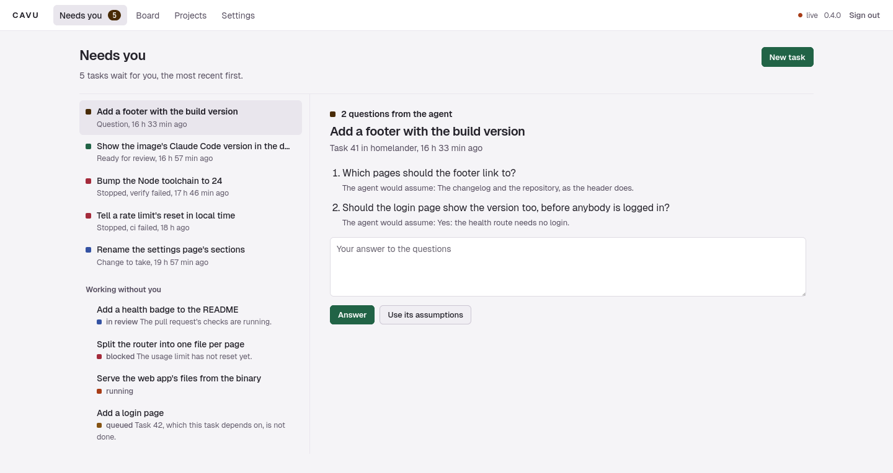
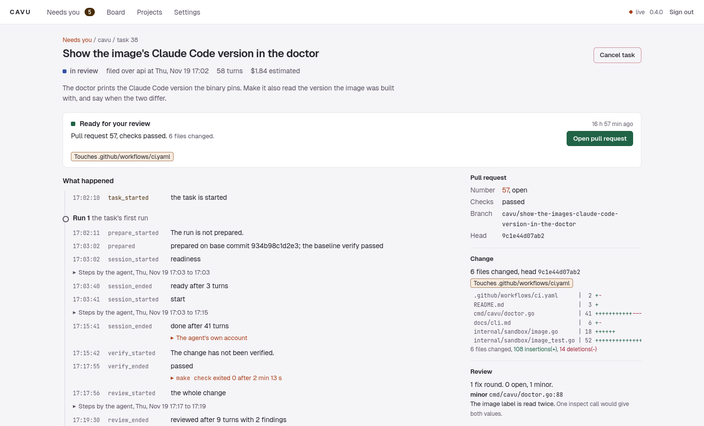
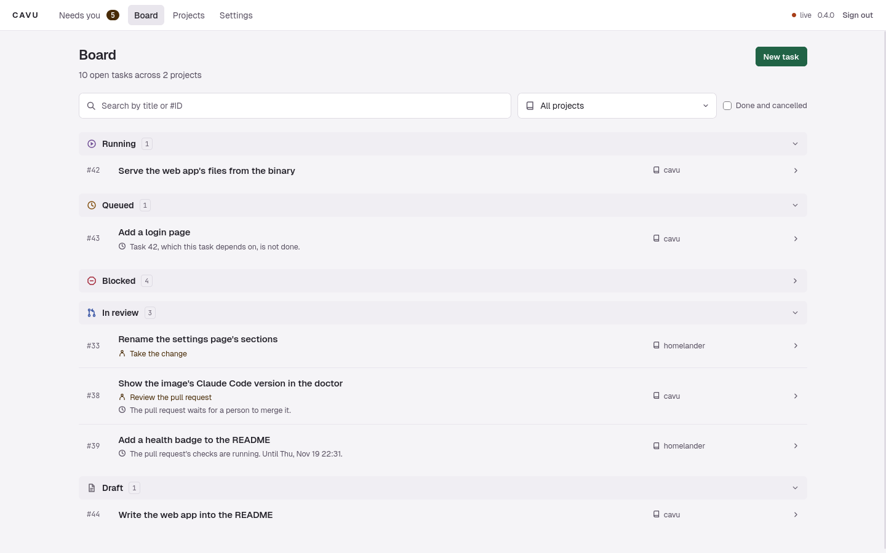
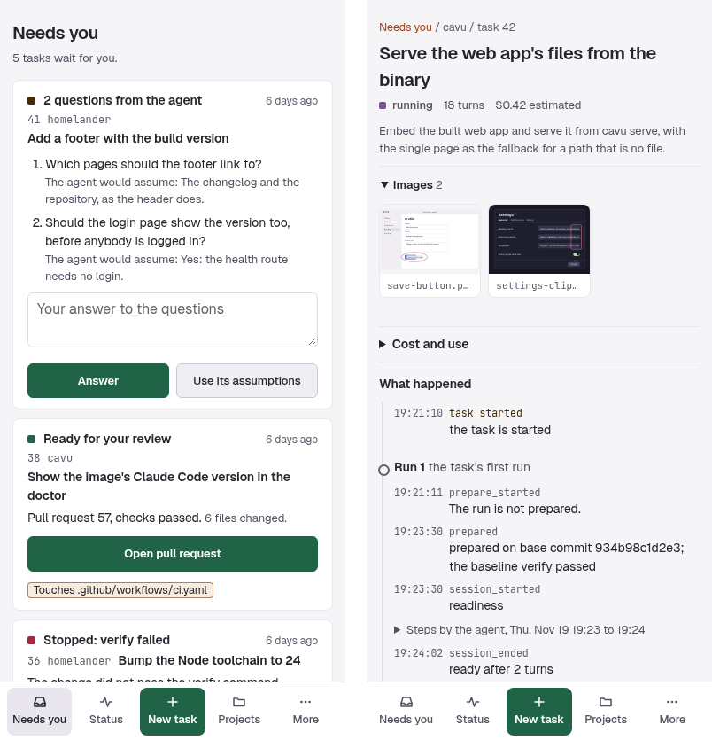

# CAVU

<picture>
  <source media="(prefers-color-scheme: dark)" srcset="docs/images/needs-you-dark.png">
  
</picture>

CAVU stands for "Containerized Agents, Verified, Unattended", and is pronounced "KAV-oo". In aviation the same letters mean "ceiling and visibility unlimited".

CAVU is meant to be a self-hosted tool that runs a coding agent fully unattended: a task goes in, a pull request comes out, and a person merges it. The agent is to run inside a container with API keys and GitHub tokens kept outside it, and a run is to count as successful only when a verify command, run by CAVU itself, passes.

## Status

Pre-release. The verbs today:

- `cavu version` prints the version.
- `cavu settings` sets and shows the settings.
- `cavu secret set` stores a secret read from standard input.
- `cavu credential` stores, lists and removes named GitHub credentials, each read from standard input.
- `cavu user set` sets the one user and their password, read from standard input.
- `cavu token` adds, lists and removes API tokens.
- `cavu image build` builds the sandbox image on Docker or Podman.
- `cavu doctor` checks the runtime, the image, the settings, the endpoint and the access to GitHub.
- `cavu project` adds, changes, lists and shows projects, and checks a project's environment, storing its baseline.
- `cavu task` adds tasks, each with the tasks it depends on, edits a task's title, body and dependencies until a new or restored task runs or is cancelled, lists them, each with whether it needs you (`--needs-you` keeps those that do), shows them, runs one in the sandbox until its pull request opens (with the switch `publish` off, until its change is ready for review) or the task stops, prints a task's diff, and records a person's start, answer, retry, cancel, merge and mark.
- `cavu replay` re-runs the marked tasks under a configuration and compares them with the last replay.
- `cavu serve` drives every started task, watches the pull requests CAVU opened, and serves the web app and the HTTP API until interrupted.
- `cavu service` runs `cavu serve` as a service of your login, a systemd user unit on Linux or a launchd agent on macOS, and removes it.

## Try it

You describe a task in plain words, on a web page or on the command line. CAVU hands it to Claude Code, an AI coding agent, which works in a sandbox: a container, a closed box on your computer that sees only what CAVU gives it, here a copy of your repository, the tools it needs and the network hosts the project allows. CAVU then checks the change with your verify command, the command that says whether the code works, such as your tests, and opens a pull request: a proposed change on GitHub, which a person reads and merges. That person is you: CAVU never merges.

### What you need

- A computer with Linux or macOS. Linux with Docker and with Podman is tested; on macOS only the unit tests run, in CI, and nothing has run there with a container runtime.
- A container runtime, Docker or Podman: the program that runs containers. CAVU starts every sandbox with it, and uses the one its `runtime` setting names, else Docker, else Podman.
- `cavu`, a single binary. On Linux it comes built, from the [releases page](https://github.com/mhersson/cavu/releases). On macOS, or to build it yourself, you need what builds it: Go (`go.mod` names the version, 1.27.4), Node (the version in `.nvmrc`, 26) with npm, `make`, and a copy of this repository.
- A Claude subscription, with Claude Code on your own machine to make the token CAVU uses (step 6), or an API key for a model endpoint together with that endpoint's address.
- A repository on GitHub, on github.com or GitHub Enterprise, for CAVU to work on, and a way for CAVU to act on it there: a personal access token, a secret that lets CAVU act on GitHub with the access the token was given, or a GitHub App installed on the repository. [GitHub access](docs/github-access.md) lists the permissions each needs.

### Getting started

Each step says what to do and what you then see. Type the commands in a terminal, and the `make` commands in your copy of this repository.

1. **Install CAVU.** On Linux, download two files from a release on the [releases page](https://github.com/mhersson/cavu/releases): `checksums.txt` and the archive for your computer, `cavu_VERSION_linux_ARCH.tar.gz`, whose `ARCH` is `amd64` where `uname -m` prints `x86_64` and `arm64` where it prints `aarch64`. In the directory that holds them, check the archive, take `cavu` out of it and move it to a directory on your `PATH`, such as `~/.local/bin`:

   ```
   sha256sum -c --ignore-missing checksums.txt
   tar -xzf cavu_VERSION_linux_ARCH.tar.gz cavu
   mkdir -p ~/.local/bin
   mv cavu ~/.local/bin/
   ```

   The check prints the archive's name and `OK`; on `FAILED`, or when it says no file was verified, do not use the archive.

   On macOS, or to build CAVU yourself, install the web app's npm packages once, then build and install `cavu`:

   ```
   make web-install
   make install
   ```

   npm may report vulnerabilities as it installs; `npm audit --omit=dev` in `web/` checks only the packages the built app ships, the `dependencies` of `web/package.json`. `make install` builds the web app, then `cavu` with the app inside it, and puts `cavu` in Go's `GOBIN` directory, else in `$(go env GOPATH)/bin`. The other way is `make build`, which writes `bin/cavu` into your copy: then type `bin/cavu` wherever this README or the documents under `docs/` say `cavu`.

   Your terminal finds `cavu` only when the directory it is in, `~/.local/bin` or Go's, is on your `PATH`. Check that it runs:

   ```
   cavu version
   ```

   It prints `cavu` and its version.

2. **Build the sandbox image.** Every sandbox starts from this image: a Debian Linux system with Claude Code, a headless Chromium, the tools a build needs, and `cavu` itself. On a network that inspects encrypted connections with a certificate authority of its own, first give CAVU that authority's certificates, a PEM file: `cavu settings set ca_bundle_path /path/to/ca.pem`. Then, with a release's `cavu`:

   ```
   cavu image build
   ```

   From source, on Linux and on macOS alike, run `make image` instead: it builds the web app and `bin/cavu` again and a Linux `cavu` for the image, then the image. Both build the image on Docker or Podman. The first build downloads Claude Code and the rest from the internet and takes a while. The runtime's steps scroll past, and the last line is `built cavu-sandbox:VERSION`, with the version `cavu version` printed. When `cavu` changes, [Upgrading](docs/running.md#upgrading) says what to run.

3. **Make your user.** CAVU has one user: the name and password you sign in with. The password needs at least 12 characters. `cavu user set` reads it from a file (or a pipe), not from what you type in the terminal: with any text editor, write the password on the first line of a new file, `password.txt`, save it, and run this with your name for `NAME`:

   ```
   cavu user set NAME < password.txt
   ```

   `<` hands the file to the command, and the line break at the end of the line is not part of the password. It prints nothing when it worked, and says so when the password is too short. CAVU keeps only a hash of the password, so you can delete the file now.

4. **Start CAVU.**

   ```
   cavu serve
   ```

   It checks the image, prints `listening on http://127.0.0.1:7117`, the address of CAVU's web page, and runs until you press Ctrl-C. Leave it running in its terminal: it runs the tasks you start and watches their pull requests. When the image is missing or belongs to another build of `cavu`, it stops at once, and its last line names the image and `cavu image build`: run that, or `make image` from source. To keep CAVU running without a terminal, or to reach it from a phone, see [Running the server](docs/running.md).

5. **Open CAVU and sign in.** Open `http://127.0.0.1:7117/` in a web browser on the same computer, and sign in with the name and password from step 3. `127.0.0.1` is the computer itself, so until you change the `listen_address` setting nothing else reaches CAVU. A new CAVU opens at **Set up CAVU**, four steps. **Save and go on** stores a step, and the page then opens the first step that is not done; a done step shows a summary and **Change**.

6. **The model endpoint.** Choose **A subscription** or **A key and an endpoint**.
   - With a subscription, paste the subscription's token into **The subscription's token**: the long-lived token that `claude setup-token` prints when you run it on your own machine.
   - With a key, fill in the **Endpoint address**, the **Auth header** that carries the key, such as `x-api-key`, and **The key**.

   Then name the **Work model**, the Claude model the agent works with, such as `claude-sonnet-5-5`. CAVU seals every secret: it stores it encrypted and never shows it again.

7. **GitHub.** Paste a personal access token into **A token for the repositories CAVU works on**, or press **Use a GitHub App instead** and give the **App id** and its **Private key**, a `.pem` file. [GitHub access](docs/github-access.md) says which permissions each needs, and why an App is recommended. Then fill in the **Name on commits** and **Email on commits**, which CAVU's commits carry.

8. **The first project.** A project is a repository CAVU works on. Give it:
   - a **Name**: lower-case letters, digits and hyphens;
   - the **Repository address**, such as `https://github.com/OWNER/REPO.git`;
   - the **Base branch**, which tasks start from and their pull requests target, `main` unless you change it;
   - a **Setup command**, which prepares the code before the agent starts, such as `npm ci` to install its dependencies, or nothing;
   - a **Verify command**, whose success means a change works, such as `make test`. When the repository has none, tick **No verify command: a person checks every change** instead.

   Press **Create and check**.

9. **The environment check.** CAVU now prepares the project the way each task's run does: it clones the repository in a sandbox, installs the tools that the files at the repository's root name (such as `go.mod`, `.nvmrc` or `.golangci.yml`), runs the setup command, and runs the verify command once on the base branch. The result is the project's baseline: tasks run only on a project whose baseline passed, or whose verify command is waived. While the check runs, the page says so and since when, or that it waits for its turn, since one check runs at a time; the first check downloads the project's tools and can take many minutes. When it ends, the page shows its result and output.
   - **It can run tasks.** The check passed: press **Create the first task**.
   - **It cannot run tasks yet.** The line names the step that failed, and the output under it shows why: `clone` points at the repository address, the base branch or the GitHub token; `toolchain` at the tool versions the repository's files name; `setup` at the setup command; `baseline` at the verify command, or at code on the base branch that does not pass it. Press **Open the project**, then **Edit**, correct what the output points at, and **Save**: CAVU checks the project again. **Check again** asks for a new check without a change, for instance after you changed the token under **Settings** or fixed the repository itself.

10. **Your first task.** Press **Create the first task**, or, when you are on the project's page after a check that passed there, **New task** on **Needs you** (on a phone, the **New task** tab). Choose the **Project**, write in one line **What should be done?**, which is the task's title, and under **Details** what done looks like and what to leave alone. Tick **Start it now**: it is not ticked at first, and a task created without it stays a draft until you press **Start** on its page. Press **Create**.

    The task's page opens. Under **What happened** it shows each step as CAVU records it:
    - The agent first reads the task and the repository and changes nothing. When a fact it needs is in neither, the task stops with its questions (step 11).
    - The agent makes the change, CAVU runs your verify command on it, and a fresh agent session reviews it; a critical or important finding sends the change back for a fix.
    - CAVU pushes a branch and opens a draft pull request on GitHub. Once the pull request's checks pass, CAVU marks it ready for review: the checks are what the repository's CI, its automatic builds and tests, reports on the pull request. When the repository has no CI, CAVU marks the pull request ready after 3 minutes and stops the task as `no_checks` 3 minutes later; to have it marked ready at once, press **Edit** on the project's page, tick **This repository has no CI** and **Save**.
    - You read the pull request and merge it on GitHub. When CAVU sees the merge, the task is done.

    <picture>
      <source media="(prefers-color-scheme: dark)" srcset="docs/images/task-page-dark.png">
      
    </picture>

11. **When CAVU needs you.** **Needs you**, the first page, lists the tasks that wait for you, the most recent first, and on a desktop the navigation shows how many. Each says what it needs:
    - **A question from the agent**: write your answer and press **Answer**; **Use its assumptions** fills in the answers the agent would assume. The task goes on with your answer.
    - **Stopped**: the box gives CAVU's explanation of the stop. Clear the cause, then press **Retry**. [The pull request](docs/tasks.md#the-pull-request) and [Budgets](docs/tasks.md#budgets) say more about their stops.
    - **Ready for your review**: **Open pull request** opens it on GitHub, where you read it and merge it.
    - **A change to take by hand**, only for a project with the switch `publish` off, which opens no pull request: **Download the bundle** or **Download the diff**, merge the change yourself, then press **Record the merge**.

    On desktop, start a task with **New task** on **Needs you** or the **Board**. On a phone, use the **New task** tab. The desktop **Board** and phone **Status** tab group open tasks by status. Select a project, search by title or task number, or collapse a group to focus the list. **Done and cancelled** includes the newest 30 tasks of each of those statuses for the selected project or across all projects. Open a cancelled task and press **Restore to draft** to edit it or start a fresh run.

    <picture>
      <source media="(prefers-color-scheme: dark)" srcset="docs/images/board-dark.png">
      
    </picture>

On a phone, use the bottom bar to open **Needs you**, **Status**, **New task**, **Projects** or **More**. See [Running the server](docs/running.md) to connect your phone to CAVU.

<picture>
  <source media="(prefers-color-scheme: dark)" srcset="docs/images/phone-needs-you-and-task-page-dark.png">
  
</picture>

### With the command line

Every step above can be done with commands instead, for those who prefer a terminal or a script. Each is described in the documents under `docs/`:

- the model endpoint and the name and email on commits: `cavu settings set` and `cavu secret set` ([Settings and secrets](docs/configuration.md#settings-and-secrets));
- GitHub: `cavu secret set forge_token`, or `cavu settings set forge_app_id` with `cavu secret set forge_app_key` ([GitHub access](docs/github-access.md));
- the first project and its environment check: `cavu project add` and `cavu project check` ([Projects](docs/configuration.md#projects));
- a check of all of it: `cavu doctor`, while `cavu serve` is stopped ([The doctor](docs/configuration.md#the-doctor));
- the first task: `cavu task add --start` and `cavu task run` ([Tasks](docs/tasks.md)).

## Documentation

- [GitHub access](docs/github-access.md): what CAVU needs of a GitHub App or a personal access token, and how to set each up.
- [Running the server](docs/running.md): `cavu serve`, the service, a phone, a proxy or a tunnel, notifications and upgrading.
- [Tasks](docs/tasks.md): adding, running and answering tasks, the pull request and its stops, and budgets.
- [Configuration](docs/configuration.md): building from source, settings and secrets, projects, the doctor, skills, Go and Python projects and replaying.
- [Security](docs/security.md): what stays outside the sandbox, who may steer the agent, and what a pull request and the network reveal.
- [API](docs/api.md): the HTTP API and the MCP tools.
- [Assumptions](docs/assumptions.md): what CAVU assumes of today's models and of the pinned Claude Code, and the test that tells when to change or delete each part.

## Licence

MIT. See [LICENSE](LICENSE).
